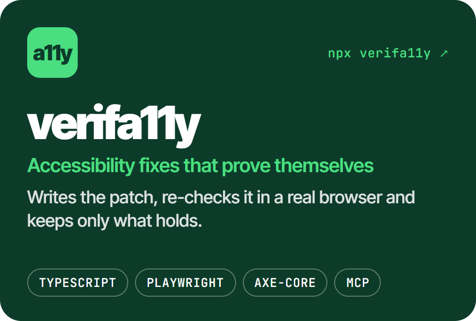
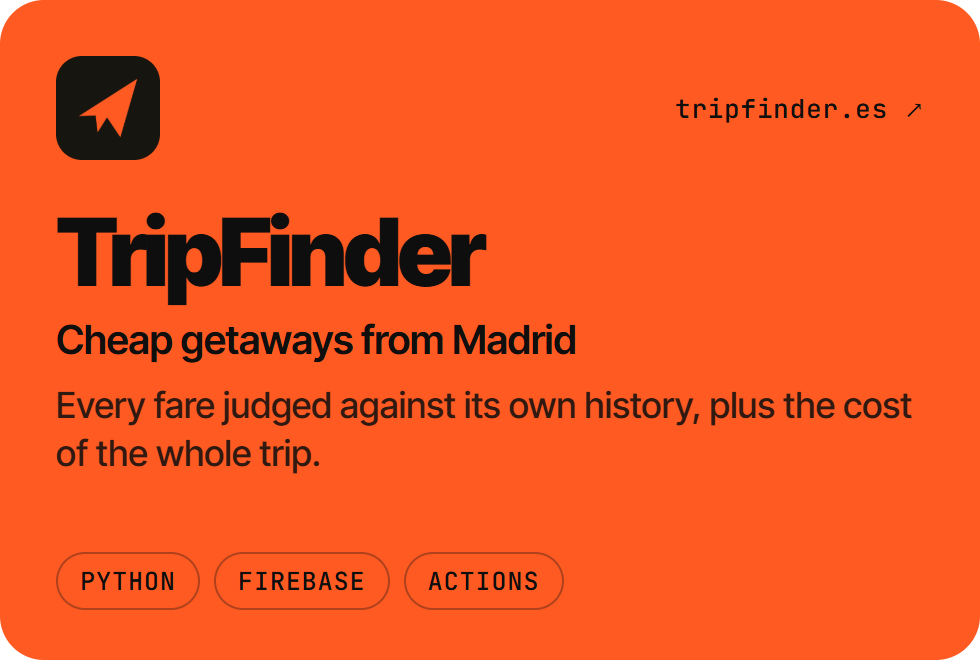
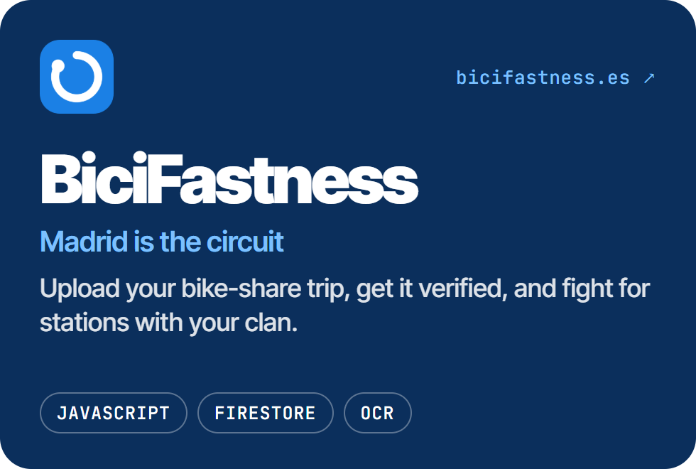
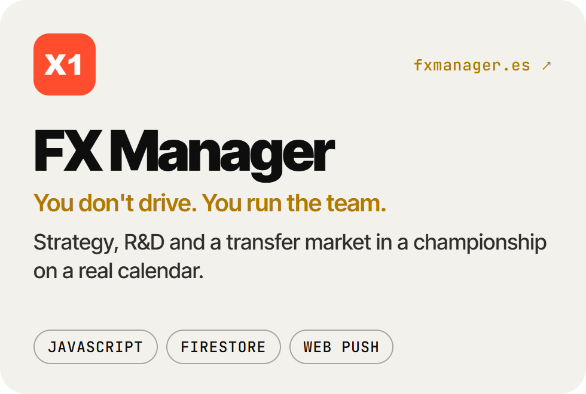

  <picture>
    <source media="(prefers-color-scheme: dark)" srcset="assets/contributions-dark.svg">
    
  </picture>

  

  <a href="https://mateogsilvaa.es"><b>mateogsilvaa.es</b></a> ·
  <a href="https://mateogsilvaa.es/cv/CV-Mateo-Gonzalez-Silva-EN.pdf">CV</a> ·
  <a href="https://www.linkedin.com/in/mateogonzalezsilva">LinkedIn</a> ·
  <a href="mailto:contacto@mateogsilvaa.es">Email</a>

  
  
  
  

  <b>Try them:</b>
  <a href="https://mateogsilvaa.github.io/verifa11y/">verifa11y</a> ·
  <a href="https://tripfinder.es">tripfinder.es</a> ·
  <a href="https://bicifastness.es">bicifastness.es</a> ·
  <a href="https://fxmanager.es">fxmanager.es</a>

